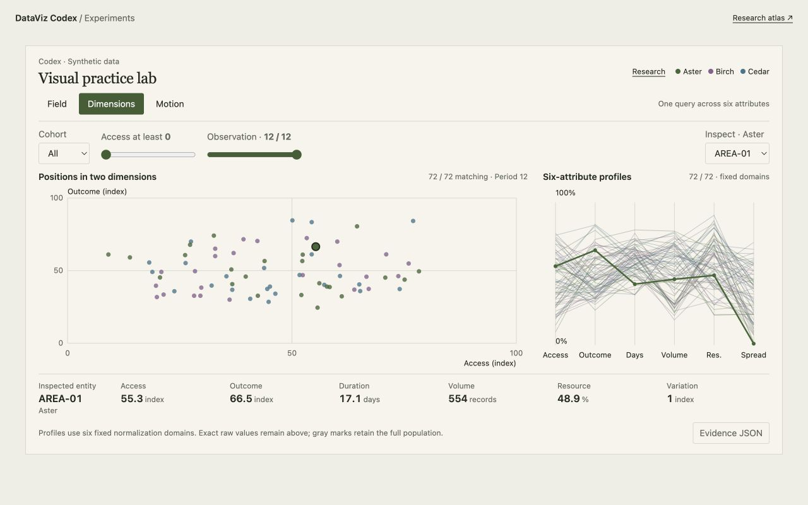

# Compact analytical experiments

Three initial instruments use the same deterministic synthetic observations. Their purpose is to test a design practice under a strict space budget. They are working prototypes, not findings about reader comprehension.

| Experiment | Interaction | Question to evaluate |
| --- | --- | --- |
| Field | Counted cells, keyboard-accessible cell zoom, exact records and a full-population distribution | Can a reader move from the population's shape to an exact observation without losing scope? |
| Dimensions | A shared cohort/access query, scatterplot, six-attribute profiles and raw values | Can a reader explain a group across several attributes while understanding filtering and normalization? |
| Motion | Direct updates, animated transitions, persistent frames and a three-cue guided explanation | Which representation supports identity tracking and accurate comparison for a particular task? |

The guided mode is an interpretation inspired by Hans Rosling's explanatory practice. It uses generated text about this fixture, not Rosling quotations or real development data. It deliberately pauses at periods 1, 6 and 12. The same tool also supports independent exploration. See the [sourced curriculum study](../../curriculum/digital-practice.md).



See the [narrow guided-motion preview](previews/motion-mobile.jpg) and [recorded viewport measurements](previews/viewport-checks.json).

## Run the Astro fixture

From the repository root:

```sh
python3 workshop/experiments/install_astro.py workshop/astro-fixture
npm ci --prefix workshop/astro-fixture
npm run dev --prefix workshop/astro-fixture
```

Open `http://127.0.0.1:4326/dataviz/experiments`. The fixture declares Astro 7.4.2, the registry version retrieved during this implementation. It is a compatibility test environment; it does not identify or upgrade the user's actual devshare.

```sh
npm test --prefix workshop/experiments
npm run build --prefix workshop/astro-fixture
CODEX_FIXTURE_BASE=/devshare/ npm run build --prefix workshop/astro-fixture
```

## Install into the actual devshare

Keep the host's existing Astro version, configuration, layout and authentication. The implementation has no UI framework or chart-library dependency.

```sh
python3 workshop/experiments/install_astro.py /absolute/path/to/astro-project
```

This installs `src/components/CodexExperiments.astro`, the isolated `public/codex-experiments/` assets, and the portable research atlas at `public/codex-reference/index.html`. It refuses to overwrite unrecognized work at those paths. It does not create or replace a host route.

In the intended Astro page, import and render the component once:

```astro
---
import CodexExperiments from '../components/CodexExperiments.astro';
---
<CodexExperiments hostOffset={128} />
```

Adjust the import for that page's location. `hostOffset` is the viewport budget reserved for host chrome, page spacing and a comfortable lower margin. Measure the actual host; the default of 128px is not a claim that every host fits. Public assets and the reference link use `import.meta.env.BASE_URL`.

Build with the host's normal command. Verify direct loading, its actual base path, any client-side navigation, reconnects, keyboard access and artifact bounds inside the real page before calling it deployed.

This follows Astro's official [custom-element guidance](https://docs.astro.build/en/guides/client-side-scripts/#web-components-with-custom-elements) and [public-asset contract](https://docs.astro.build/en/basics/project-structure/#public).

## Measurement and state

- Fixture `codex-compact-fixture-v1`: seed 1031, 72 fictional service areas, three cohorts, six attributes and 12 discrete periods; 864 observations total.
- Access and outcome use fixed 0–100 index axes. The field is not a geographic map.
- Field cell counts conserve the matching population. Zoom changes the visible field; its visible count is reported separately from query membership.
- Dimensions applies cohort and an inclusive minimum access threshold at the current period. Gray marks retain the complete population. The profile chart normalizes each feature using its explicitly fixed domain; this does not imply equivalent units or importance. Exact values remain in the selected record strip.
- Motion uses the same twelve IDs in every period, four per cohort. Only the cohort selection applies there; the Dimensions threshold is inactive. Interpolation is display behavior, not an additional observation. The selected trajectory joins the discrete observations.
- Small screens switch between positions and profiles instead of stacking both. Counts, scope and exact values persist.
- Evidence JSON contains the query/view state, matching records, visible IDs, feature domains and all 864 observations. Export is a local browser download, not transmission to an external agent.

## Spatial contract and evidence

See [constraints](../constraints.md) and the [verification record](verification.md). The primary graphic, controls, scope, units, cohort legend, selected facts and export fit above the fold in the tested Astro fixture. There is no internal vertical scrolling or page-level horizontal overflow.

The implementation and layout checks establish behavior and fit. A reader study is still needed to compare comprehension, accuracy and task time across the three instruments and their static alternatives. Record preference separately from performance.
